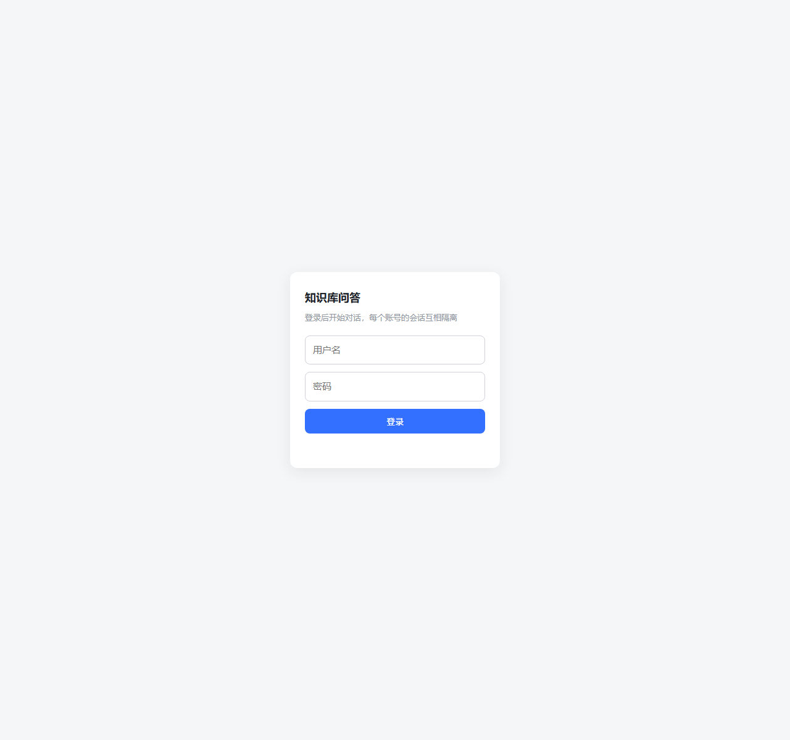
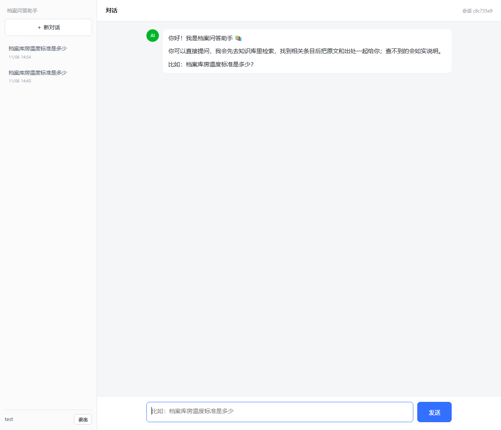
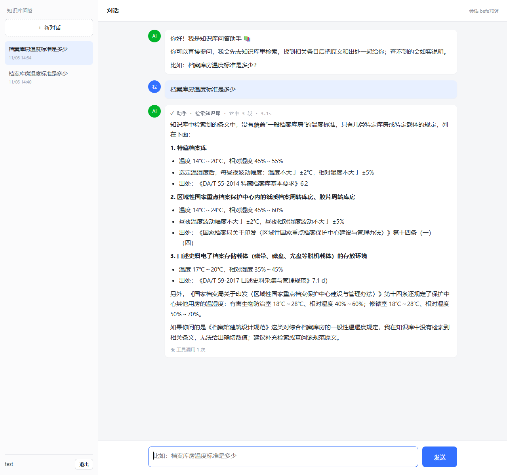

# 知识库问答演示

一个网页版的知识库问答助手。提问后它会先去 Milvus 里检索，把命中的原文段落连同出处交给模型，答案只基于检索结果。

在线演示：https://rag.langxo.com
(test/test)

## 界面

登录后进入对话页，左边是历史会话，右边是聊天区。



新开会话时先给一段说明，直接提问就行。



提问后先看到检索动作（命中几段、耗时多少），再给出带出处的答案，底部标着本轮工具调用次数。



## 知识库内容

语料是档案领域的公开材料，放在仓库的 documents 目录下，按四类整理：

| 目录 | 内容 | 规模 |
| --- | --- | --- |
| 01_采购卷宗 | 各类政府采购项目的公开招标公告，每组一份公告原件加一个来源说明 | 30 组 |
| 02_政策法规 | 国家档案局网站发布的法律法规附件，如《中华人民共和国档案法》《档案法实施条例》《企业档案管理规定》 | 26 份 |
| 03_档案目录 | 部分档案馆的开放档案目录公告与目录页面 | 4 份 |
| 05_中标公告 | 采购项目的中标结果公告，同样一组一份原件加来源说明 | 60 组 |

04_标准规范（档案行业标准文本）体积有 145 MB，没有放进仓库，需要的话自己补进 documents 目录再入库。

提问可以围绕这些内容展开，比如：

- 档案库房的温湿度标准是多少
- 《档案法》对档案开放期限是怎么规定的
- 企业档案管理有哪些要求
- 某个采购项目的预算和中标金额是多少
- 哪个单位中标了某某设备采购

## 检索链路

`retrieve_doc` 这一个工具做三件事：先用 DashScope 的 embedding 模型把问题向量化，再在 Milvus 里同时发起稠密和稀疏两路检索，最后用 gte-rerank 做重排，取前 3 段返回。

稀疏那一路依赖集合里的 BM25 函数，所以每段命中的都是正文原文，不是摘要。返回的文本带 `[文档: 文件名]` 前缀，模型据此标注出处。

## 页面上能看到什么

打开先登录，账号由服务端预置，不开放注册。左边是历史会话列表，可以切换、可以新建；每轮的工具步骤（检索了几次、命中几段、耗时多少）会随消息一起存档，刷新或切回来都还在。

回复过程中实时显示模型的思考过程、每次工具调用和返回摘要；正文按 Markdown 渲染。底部有一行本轮工具调用次数。

## 目录

```
app/
  main.py              FastAPI 入口，启动时建 agent 和数据库
  api/v1/chat.py       对话、历史、会话列表
  api/v1/auth.py       登录、当前用户
  agents/kb.py         检索工具和 agent 组装
  agents/llm.py        让思考过程能从流里透出来
  core/auth.py         密码哈希和 JWT
  db/                  用户、会话索引、步骤存档、缓存
  static/index.html    单页界面
```

## 本地运行

装依赖：`pip install -r requirements.txt`。

在项目根目录建 `.env`，填下面这些，然后 `py -m uvicorn app.main:app --port 8001`，浏览器打开 http://127.0.0.1:8001。

## 环境变量

| 变量 | 用途 |
| --- | --- |
| LLM_MODEL_ID / LLM_API_KEY / LLM_BASE_URL | 对话模型，走 OpenAI 兼容接口 |
| DASHSCOPE_API_KEY | embedding 和重排都走 DashScope |
| MILVUS_URI / MILVUS_TOKEN | Milvus 地址和口令 |
| MILVUS_COLLECTION | 要检索的集合名，默认 my_document_collection |
| EMBED_MODEL / RERANK_MODEL | 向量模型和重排模型 |
| JWT_SECRET_KEY | 登录令牌签名用，部署前换成随机串 |
| ADMIN_PASSWORD / TEST_PASSWORD | 两个预置账号的密码 |

## 用 Docker 部署

```
docker compose up -d --build
```

只对外开 127.0.0.1:8101，外网访问交给 nginx 反代。会话、用户、步骤存档都挂在命名卷 rag_data 上，重建容器数据不丢。
